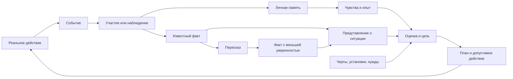

# Социальные системы NPC: от события до решения

Этот документ описывает **текущее поведение игры**. В нём `feeling` и `attitude`
оставлены рядом с русскими названиями, чтобы их было легко найти в коде. Речь
идёт прежде всего о разумных живых NPC при включённой настройке NPC personalities.
Игрок может иметь записи об отношениях, но не получает NPC-шкалы и стартовые
черты.

## Короткий ответ

**Feeling (чувство)** — сохранённая оценка человека, группы или фракции в
`RelationshipRecord`, от −100 до +100. Например, помощь может прибавить чувство
к помощнику, нападение — уменьшить. У одного NPC есть *отдельные* записи о
конкретном человеке, его группе и его фракции.

**Attitude (текущее отношение к человеку)** — вычисляемый результат, а не ещё
одна сохранённая шкала. `PersonalitySystem.Attitude(наблюдатель, цель)` складывает
чувства к человеку, **нынешней** группе и фракции цели, а также возможное
смещение от черты, связанной с фракцией. Результат ограничен диапазоном
−100..100. Если наблюдатель уверенно знает о серьёзном неразрешённом нарушении
этого человека (`Violation ≥ 80`, `ViolationConfidence ≥ 80`), результат не
может быть выше −30. Старые положительные чувства при этом сохраняются.

Таким образом, `Feeling = +40` к знакомому и `Attitude = −30` к нему же
совместимы: знакомый всё ещё дорог NPC, но тот считает его нынешнее поведение
неприемлемым. После действительного разрешения инцидента ограничение исчезает,
и прежние чувства снова влияют на решения.

## Из чего складывается социальное поведение

### 1. Черты и шкалы самого NPC

`TraitInstance` — сохранённая черта вроде `kind`, `honest`, `reliable` или
`hotheaded`. У черты есть эффекты на оси `NpcPersonalityAxis`. NPC начинает с
трёх стартовых черт; другие можно получить через опыт. Черта может одновременно
влиять на несколько решений. Полный перечень — в
[справочнике черт](npc-traits-guide.md).

Оси бывают двух видов:

- **Склонности решения** (`Bias`): предметы, смелость, группа, закон, торговля,
  исследование, сострадание, припасы. Их значение получают из активных черт.
  `Law +20` повышает вес связанных с законом решений, а не задаёт шанс 20 %.
- **Меняющиеся установки** (`Disposition`): ценность человеческой жизни
  (`HumanLife`), круг заботы (`CareCircle`), доверие сообщениям (`MessageTrust`),
  тревога о дефиците (`Scarcity`) и терпение (`Patience`). Эффективное значение
  складывается из основы фракции, эффектов черт, **накопленного опыта** после
  разрешения воспоминаний и временного влияния голода, усталости или рассудка.
  Оно ограничено диапазоном −100..100. Сама сохранённая прибавка от опыта —
  только один из этих компонентов.

Эти оси характеризуют **наблюдателя**. Они отвечают на вопросы «как я отношусь
к насилию?», «склонен ли я верить рассказу?», «готов ли терпеть отказ?». Они не
являются оценкой конкретного знакомого. Текущая `Frustration` — ещё одно
кратковременное состояние: отказы и конфликты её поднимают, время и удачное
урегулирование снижают; терпение определяет, насколько легко NPC сорвётся.

### 2. Отношения с конкретными людьми и коллективами

`PersonalityState` хранит отдельные `RelationshipRecord` по устойчивым ID людей,
групп и фракций. В каждой записи есть `Feeling`; у персональной записи также
есть `Trust`, `Fear`, `Attachment`, `Grievance` и `Debt` (0..100): доверие,
страх, привязанность, обида и долг. Это разные величины. Например, можно
испытывать привязанность и одновременно держать обиду. Смена лидера не стирает
историю группы; одинаковые имена людей не объединяют записи.

Память о помощи или нападении меняет `Feeling` к участнику; эффект на его
группу и фракцию слабее. Слух, принятый с достаточным доверием, может изменить
мнение о названном человеке или фракции **без личного воспоминания о событии**.
Черта, привязанная к фракции, добавляет смещение при расчёте отношения к её
члену.

Для контекста целей есть похожий, но другой расчёт:

`NpcMotivation.Feeling = clamp(person.Feeling + group.Feeling + faction.Feeling + factionTraitBias + (Trust − Fear − Grievance) / 4)`.

Здесь `Feeling` — **поле мотивации**, рассчитанное по сохранённым чувствам и
социальным показателям, а не поле `Feeling` одной записи. Значение не включает
ограничение за `Violation`. `NpcValues.KnownAttitude` сейчас использует тот же
социальный расчёт и потому, несмотря на имя, не тождественно
`PersonalitySystem.Attitude`.

`TrustInLeader` — ещё отдельная игровая величина доверия **текущему лидеру**.
Она влияет, например, на сделки с ним и не равна `RelationshipRecord.Trust`.
При исключении из группы членство и это доверие меняются отдельно от
накопленной истории чувств.

### 3. Наблюдение, память, знание и слухи

Это четыре связанных, но разных вещи:

- **Значимое событие** (`SignificantEvent`) появляется после реального
  действия: подарка, нападения, кражи, обещания, ответа на предупреждение и
  т. п. У события есть участники, место, время и причинные ID.
- **Личная запись о пережитом** (`ObservedEvent`) появляется у участника или
  очевидца согласно правилам видимости. Подходящее событие запускает
  `MemoryInstance`: воспоминание сразу влияет на отношения и остаётся в их
  истории. Обычно через два игровых дня оно разрешается и может изменить
  черту, навык или накопленный опыт по установке. Это не то же самое, что
  узнать новость из разговора.
- **Знание** (`NpcKnowledge`) хранит факты (`NpcFact`), известных людей,
  места и выходы. Запись об известном человеке (`NpcKnownPerson`) содержит
  последний известный контекст: место, нужду в еде или медицине, опасность,
  подозреваемое нарушение, уверенность, причину, известное членство. Это
  представление NPC о мире; оно может быть неполным или устаревшим.
- **Слух** — пересказ сохранённого факта. Источник меняется на `Told`, число
  пересказов растёт, уверенность слушателя вычисляется из уверенности
  рассказчика, доверия и обиды к нему, склонности к группе и `MessageTrust`.
  Прямое наблюдение надёжнее слабого пересказа. Услышанное может менять
  репутацию и порождать цели, но не выдаёт слушателю память очевидца.

`Hostile` у известного человека отражает вражду по игровым правилам боя
(`AreEnemies`). Оно не означает «не нравится». NPC может быть боевым не-врагом,
но не желать с ним жить в группе. И наоборот, факт нарушения имеет свою
уверенность и не превращается в боевую вражду автоматически.

### 4. Обязательства, договорённости и привязанности

Кроме черт, шкал и памяти, у NPC сохраняются конкретные социальные состояния:

- **Обещание** (`NpcCommitment`) связывает обещавшего, получателя, ресурс,
  остаток и срок. Настоящая передача ресурса исполняет его; освобождение от
  обещания завершает без нарушения. Просрочка даёт получателю частную оценку
  `promise_broken`, запись в Read Records и факт, который он может пересказать.
  Автоматической рассылки слуха всем вокруг нет.
- **Договор об услуге**, разрешение на припасы, спор и привязанность к человеку,
  предмету или дому живут отдельно от общей симпатии. Они могут сделать
  конкретную цель актуальной даже при смешанных чувствах.
- **Группа и фракция** имеют фактическое членство и задания. Личные чувства к
  коллективу — ещё один слой; они не меняют членство сами по себе.

Есть черта `reliable` («надёжный»): она может появиться после исполненного
обещания, требует `honest` и добавляет склонности к закону и состраданию.
Недоверие к получателю само по себе сейчас не снимает действующее обещание.
При этом, как и другая цель, исполнение может задержаться из-за выживания,
невозможного маршрута, отсутствия ресурсов или боевой вражды.

### 5. Цели, планы и действия

`NpcGoalGenerator` сопоставляет нужды и **известные** обстоятельства с
ценностями NPC: питание, помощь, безопасность, справедливость, принадлежность,
исполнение обещаний и другими. У предложенной цели есть недостаток состояния,
важность и уверенность в фактах; её полезность вычисляется как
`deficit × importance × confidence / 10000`. Затем планировщик ищет допустимые
действия, а AI проверяет их при исполнении. Предложение цели ещё не означает,
что NPC немедленно совершит действие.

Существуют также личные намерения и длительные интересы, групповые и
фракционные задания. Они используют черты, отношения, знания и физические
условия, но могут иметь **свои** правила допуска. Поэтому социальная реакция
не сводится к одному глобальному числу.

## Как всё соединяется

Read Records показывает сохранённую ретроспективную историю NPC, включая
события, цели и их исходы. Это **инструмент просмотра истории вне игрового
знания персонажей**: запись в архиве не означает, что все жители о ней знают.
Во время игры NPC видит только своё наблюдение и полученные сведения.

## Пример: два полицейских поссорились

Допустим, Джеральд хорошо помнит помощь Ллойда и его личное `Feeling`
положительно. Затем Джеральд узнаёт о серьёзной краже Ллойда с высокой
уверенностью. В `NpcKnownPerson` Ллойда появляется `Violation = 100`, поэтому
расчётный `Attitude` Джеральда к нему становится не выше −30. Если Ллойд состоит
в группе Джеральда, у лидера появляется основание для исключения; тот же порог
не позволяет тут же пригласить его обратно.

Предупреждение само по себе не разрешает нарушение. Ллойд отвечает согласно
своим склонностям к закону и состраданию, терпению и текущей фрустрации.
Принятие границы Джеральд оценивает **своими** состраданием, законом, терпением,
доверием сообщениям и обидой. Только принятый ответ, относящийся к текущему
инциденту, может снять ограничение `Violation`. Старое положительное чувство
после этого опять учитывается, но членство не восстанавливается автоматически:
нужны обычные условия и отдельное приглашение. Извинение может уменьшить
обиду и прибавить доверие без отмены нарушения.

Важная техническая тонкость: обычная цель помочь с едой использует
`NpcMotivation.Feeling`, а не `Attitude`, и проверяет `Hostile` как боевую
вражду. Поэтому положительные старые воспоминания могут всё ещё делать помощь
интересной даже после отказа в совместной жизни. Медицинская помощь также
учитывает ценность жизни. Это разные решения с разной ценой; они не обязаны
иметь один порог. Обычное **групповое** задание принести еду человеку с таким
нарушением уже не предлагается, но срочная групповая медицина возможна.
Если получатель вышел из группы, групповое задание прекращается.

## Где искать реализацию

- Шкалы, черты, память и записи отношений: `WRogue/Data/PersonalityState.cs`,
  `WRogue/Gameplay/Npc/Runtime/PersonalitySystem.cs`.
- Сложение чувств: `WRogue/Gameplay/Npc/Relationships/NpcRelationshipValue.cs`.
- Известные люди, факты и слухи: `WRogue/Data/NpcKnowledge.cs`,
  `WRogue/Gameplay/Npc/Knowledge/NpcKnowledgeSystem.cs`,
  `WRogue/Gameplay/Npc/Conversation/NpcConversation.cs`.
- Цели и их мотивация: `WRogue/Gameplay/Npc/Goals/NpcGoalContext.cs`,
  `WRogue/Gameplay/Npc/Goals/NpcValues.cs`.
- Предупреждения, ответы и разрешение нарушения:
  `WRogue/Gameplay/Npc/Content/Justice/JusticeModule.cs`.
- Обещания и последствия: `WRogue/Gameplay/Npc/Content/Promises/`.

Для деталей о памяти и чертах см. [NPC traits and memories](npc-personality.md);
о целях и планах — [Trait-driven NPC intentions](npc-intentions.md).
