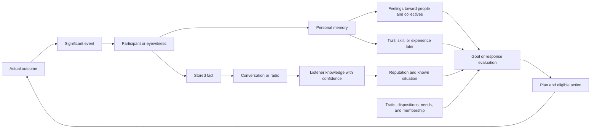

# NPC social systems: from event to decision

This document maps the **entire implemented social system**: what makes up an NPC's personality, what they know about others, how events become feelings and goals, and where each layer lives in the code. Names such as `Feeling` and `Attitude` match the source code. This primarily concerns intelligent living NPCs with NPC personalities enabled. The player can have relationship records but does not receive NPC axes or starting traits.

This is an overview of how the subsystems interact. Complete trait values and IDs are maintained in the [trait guide](npc-traits-guide.md), memory and relationship mechanics in [npc-personality.md](npc-personality.md), goals and planning in [npc-intentions.md](npc-intentions.md), specific social episodes in [npc-social-stories.md](npc-social-stories.md), and the module extension contract in [npc-content-modules.md](npc-content-modules.md). This page explains the concepts, their connections, and the canonical code locations.

The [interactive social atlas](social-graph.html) shows the registered content graph and, after a save export, the Read Records graph for each NPC. [Export instructions and interpretation limits](social-graph.md) explain what each link represents.

## Overall model

The game has no single "social score" or decision-making center. Several layers coexist on each NPC:

1. **Who I am:** traits, decision biases, changing dispositions, and short-lived emotions. They affect the interpretation of *any* situation.
2. **What I have experienced:** personal events and memories. Experience can change a trait, skill, disposition, or relationship with participants.
3. **What I think of others:** feelings toward people, groups, and factions; trust, fear, attachment, grievance, debt, and separate trust in a leader.
4. **What I know:** people seen and places visited, needs, dangers, violations, and verified or retold facts with a source and confidence level.
5. **What I have promised and pursue:** commitments, agreements, attachments, interests, personal goals, plans, and collective assignments.
6. **What actually happened:** an action and a significant event. Only an action that was carried out changes the world and gives others grounds to react.

The first two layers are not knowledge about every resident in town. The third and fourth are subjective: two witnesses may judge the same person differently. The fifth competes with hunger, danger, resources, and the ability to reach the target. Faction and group membership and combat hostility rules remain factual game states; they are not inferred from affection.

`NpcPersonalitiesEnabled` enables this additional layer for intelligent living NPCs. When disabled, `Bias` and `Attitude` return neutral values and the social intention generator does not run; the usual faction, group, survival, and combat rules still apply. The personality system supplements the existing `MemorizedSensor`, explored places in `ExplorationData`, combat hostility, and trust in a leader. It does not replace them with a single store.

## Short answer

**Feeling** is a stored evaluation of a person, group, or faction in a `RelationshipRecord`, ranging from −100 to +100. For example, help can raise the feeling toward the helper, while an attack can lower it. One NPC has *separate* records for a particular person, that person's group, and their faction.

**Attitude toward a person** is a computed result, not another stored scale. `PersonalitySystem.Attitude(observer, target)` combines feelings toward the person, the target's **current** group and faction, and any bias from a trait associated with that faction. The result is clamped to −100..100. If the observer knows with high confidence about a serious unresolved violation by that person (`Violation ≥ 80`, `ViolationConfidence ≥ 80`), the result cannot exceed −30. Earlier positive feelings remain stored.

Thus, `Feeling = +40` and `Attitude = −30` toward the same acquaintance can coexist: the NPC still cares about the person but considers their current behavior unacceptable. Once the incident is actually resolved, the cap disappears and earlier feelings influence decisions again.

## Components of social behavior

### 1. The NPC's own traits and axes

`TraitInstance` is a stored trait such as `kind`, `honest`, `reliable`, or `hotheaded`. A trait has effects on `NpcPersonalityAxis` axes. An NPC starts with three starting traits and one or two unresolved starting memories; other traits can be acquired through experience. A trait may affect several decisions at once. See the [trait guide](npc-traits-guide.md) for the full list.

There are two kinds of axes:

- **Decision biases** (`Bias`): items, courage, groups, law, trade, exploration, compassion, and supplies. Their values come from active traits. `Law +20` increases the weight of decisions related to law; it does not set a 20% chance.
- **Changing dispositions** (`Disposition`): the value of human life (`HumanLife`), breadth of concern (`CareCircle`), trust in messages (`MessageTrust`), concern about scarcity (`Scarcity`), and patience (`Patience`). The effective value combines a faction baseline, trait effects, **accumulated experience** from resolved memories, and temporary effects of hunger, fatigue, or sanity. It is clamped to −100..100. The stored experience increment is only one component.

These axes describe the **observer**. They answer questions such as "How do I feel about violence?", "Am I inclined to believe a report?", and "Will I tolerate a refusal?" They do not evaluate a particular acquaintance. Current `Frustration` is another short-lived state: refusals and conflicts raise it, while time and successful settlements reduce it. Patience determines how easily the NPC loses their temper.

The eight biases serve as general weights for different decisions. `Item` affects the evaluation of finds; `Courage` affects responses to danger and confrontation; `Group` affects joint actions and leadership; `Law` affects responses to violations; `Trade` affects exchange; `Explore` affects movement and exploration; `Compassion` affects helping; and `Supplies` affects finding and conserving resources. These are not eight mutually exclusive personality types: someone can be brave, thrifty, and helpful at the same time. `PersonalitySystem.Bias` sums the effects of active traits for one bias, including conditional effects for a particular item.

The five dispositions have their own accumulated histories:

- `HumanLife` is the value placed on human life. It affects protection, revenge, medical help, and emotional responses to killing. Compassion and law also feed into it; a severe loss of sanity temporarily lowers it.
- `CareCircle` measures how far concern extends beyond close associates. It affects helping a stranger; hunger and lack of sleep temporarily narrow it. Effects from `Group` and `Compassion` contribute to it in part.
- `MessageTrust` measures willingness to consider reports credible. It helps determine confidence in rumors and responses to disproven claims. Low sanity temporarily lowers it.
- `Scarcity` is concern about insufficient resources. It reduces willingness to give away food and raises the value of stockpiles. Hunger raises it, but edible food in the inventory softens this temporary effect.
- `Patience` applies during arguments, refusals, threats, warnings, and apologies. Hunger, lack of sleep, and low sanity temporarily lower it. For example, `patient` adds patience, while `hotheaded` greatly reduces it.

`PersonalitySystem.Disposition` computes the effective disposition; it is **not identical** to the stored `ExperienceValue`. On observing a significant event, `NpcImmediateEmotion` can separately change recoverable sanity right away. Later resolution of a memory can shift accumulated experience. These are different responses with different lifetimes.

#### Available traits

The standard catalog currently has **116 traits**: 50 starting and 66 acquired. A trait has a stable string ID, a name, effects on axes, an optional acquisition condition, conflicts, and sometimes special behavior. For example, `kind` adds compassion and group bias; `honest` raises law and trade; `deceptive` can falsely claim permission to take supplies; and `likes_items` applies to a particular item model. Opposing starting traits such as `kind`/`cruel`, `lawful`/`rebellious`, and `sociable`/`solitary` are not assigned together.

Acquired traits are grouped **by source of experience**, not by separate application mechanisms:

- **24 personal outcomes:** survival, violence, help, betrayal, promises, and other experiences. Examples include `selfless`, `mistrustful`, `protector`, `reliable`, and `disillusioned`.
- **9 encounters with unique characters:** from `bear_resolve` after meeting Big Bear to `sewer_dread`.
- **18 faction relationships:** the `friend_*` and `wary_*` families, acquired after helping, attacking, or killing when the starting trait qualifies. They provide ordinary bias effects and a shift in attitude toward members of a particular faction. Not every faction has both variants; conflicting variants for one faction are incompatible.
- **15 world experiences:** for example, `refugee_solidarity`, `army_confidence`, `roadside_vigilance`, `convoy_hope`, and `betrayal_scar`. They require the corresponding observed encounter or world event and can change attitude toward a faction.

The exact name, ID, numerical effects, and condition for each of the 116 traits are listed in the [trait catalog](npc-traits-guide.md). It is the single complete reference for values and IDs; this document explains how the engine uses them. A new trait does not need its own AI branch: the usual approach is to register its effects on shared axes. For special behavior, a module can add an interest, goal source, event response, or operator.

### 2. Relationships with particular people and collectives

`PersonalityState` stores separate `RelationshipRecord` entries keyed by stable IDs for people, groups, and factions. Every record has `Feeling`; a personal record also has `Trust`, `Fear`, `Attachment`, `Grievance`, and `Debt` (0..100). These are distinct values. An NPC can feel attached to someone while also holding a grievance. Changing the leader does not erase the group's history; identical names do not merge people's records.

A memory of help or an attack changes `Feeling` toward the participant; its effect on the participant's group and faction is weaker. A rumor accepted with sufficient trust can change an opinion about the named person or faction **without a personal memory of the event**. A faction-linked trait adds a bias when calculating attitude toward a member of that faction.

Goal context uses a similar but different calculation:

`NpcMotivation.Feeling = clamp(person.Feeling + group.Feeling + faction.Feeling + factionTraitBias + (Trust − Fear − Grievance) / 4)`.

Here `Feeling` is a **motivation field** calculated from stored feelings and social values, not the `Feeling` field of one record. It does not include the `Violation` cap. `NpcValues.KnownAttitude` currently uses the same social calculation and, despite its name, is therefore not identical to `PersonalitySystem.Attitude`.

`TrustInLeader` is yet another game value: trust in the **current leader**. It affects, for example, trading with that leader and is not the same as `RelationshipRecord.Trust`. On expulsion from a group, membership and this trust change separately from the accumulated history of feelings.

### 3. Observation, memory, knowledge, and rumors

These are four related but distinct things:

- A **significant event** (`SignificantEvent`) follows a real action: a gift, attack, theft, promise, response to a warning, and so on. It has participants, a place, a time, and causal IDs.
- A **personal record of an experience** (`ObservedEvent`) is created for a participant or eyewitness according to visibility rules. A qualifying event triggers a `MemoryInstance`: the memory immediately affects relationships and stays in their history. It normally resolves after two game days and may change a trait, skill, or accumulated disposition experience. This differs from hearing news in a conversation.
- **Knowledge** (`NpcKnowledge`) stores facts (`NpcFact`), known people, places, and exits. A known person's record (`NpcKnownPerson`) contains the last known context: location, need for food or medicine, danger, suspected violation, confidence, cause, and known membership. It is the NPC's view of the world and may be incomplete or outdated.
- A **rumor** is a retelling of a stored fact. Its source becomes `Told`, its retelling count rises, and the listener's confidence is computed from the speaker's confidence, trust and grievance toward the speaker, group bias, and `MessageTrust`. Direct observation is more reliable than a weak retelling. What is heard may change reputation and produce goals, but it does not give the listener an eyewitness memory.

`Hostile` on a known person reflects hostility under the game's combat rules (`AreEnemies`). It does not mean "disliked." An NPC may not be a combat enemy yet still be unwelcome in a group. Conversely, knowledge of a violation has its own confidence and does not automatically create combat hostility.

### 4. Commitments, agreements, and attachments

Besides traits, axes, and memories, NPCs retain specific social states:

- A **promise** (`NpcCommitment`) connects the promisor, recipient, resource, remaining amount, and deadline. Actual transfer of the resource fulfills it; release from the promise ends it without a breach. Missing the deadline gives the recipient a private `promise_broken` assessment, an entry in Read Records, and a fact they can retell. Rumors are not automatically broadcast to everyone nearby.
- A **service agreement**, permission to take supplies, dispute, and attachment to a person, item, or home exist separately from general affection. They can make a specific goal relevant despite mixed feelings.
- **Groups and factions** have actual membership and assignments. Personal feelings toward a collective are another layer and do not change membership on their own.

The `reliable` trait can be acquired after fulfilling a promise, requires `honest`, and adds law and compassion biases. Distrust of the recipient alone does not currently cancel an active promise. As with any other goal, fulfillment can be delayed by survival needs, an impossible route, insufficient resources, or combat hostility.

### 5. Goals, plans, and actions

`NpcGoalGenerator` matches needs and **known** circumstances against NPC values: nutrition, care, safety, justice, belonging, keeping promises, and others. A proposed goal has a state deficit, importance, and confidence in its facts. Its utility is calculated as `deficit × importance × confidence / 10000`; it needs at least 20 to start independently. Existing categories of significant states are `Nutrition`, `Care`, `Reciprocity`, `Safety`, `Justice`, `Belonging`, `Autonomy`, `Recovery`, `MedicalCare`, `Commitment`, `Restitution`, `Possession`, and `ProtectHome`; modules can register additional string values. Faction policy adds its own priorities for care, safety, resources, and shelter. The planner then finds legal actions, and the AI rechecks them when executing them. Proposing a goal does not mean the NPC will act immediately.

There are also personal intentions and long-term interests, as well as group and faction assignments. They use traits, relationships, knowledge, and physical conditions, but may have **their own** eligibility rules. A social response therefore cannot be reduced to one global number.

## Lifecycle of an event

1. A game action first passes the normal rule checks and is **actually performed**. For example, an item moves between inventories, group membership changes, or a blow lands. The successful handler reports a `SignificantEvent` through `RogueGame.ReportPersonalityEvent` or through `NpcEvents.Publish` from a module. An attempt, consideration of an action, or calculation of a plan does not count as an accomplished outcome.
2. `PersonalitySystem.Report` checks the event contract in the active catalog, assigns an ID, and identifies direct participants and residents who can see it. For a private event (`isPrivate`), the audience is limited to the owner of the assessment. A participant or eyewitness gets an `ObservedEvent` with participants, time, `CauseId`, and `StoryId`. An entry also goes into their saved `ResidentRecords` history.
3. For each observer, `NpcEventPipeline` first updates knowledge of visible participants, calls `Knowledge` subscribers, saves a fact if the event is declared retellable, then calls `Relationships` subscribers and updates evidence for active memories. Matching `MemoryTrigger` definitions create personal `MemoryInstance` entries; feelings toward participants change at creation time. The `Goals` phase then updates goal proposals, while `Responses`/`Replies` may prepare a response.
4. A response is also an action. `NpcReaction` holds a short pending statement or outburst, but the response event is published when the NPC actually speaks or acts. Thus a warning, agreement, and actual correction of an act can be distinguished and linked by causal IDs.
5. Once all observers have been processed, the shared episode is updated and `AfterEvent` subscribers run. For example, a food transfer publishes `shared_food`, and the promises module checks whether that transfer fulfilled an active promise.
6. Due memories resolve on a separate map turn. After two game days, an available outcome is selected from "gain a trait," "improve a skill," "remove a conflicting trait," and "change disposition experience." Neither the event nor the trait guarantees a particular outcome. A resolved memory leaves the pending queue but remains in the corresponding relationship history with its outcome and time.

### When an event becomes a rumor

Only an event with `RetainFact`, or a separate eligible inference stored as an `NpcFact`, can be retold. A fact has an event ID, source (`Participant`, `Witness`, `Told`, or `Inferred`), place, event and discovery times, confidence, retelling count, and known names of participants. `NpcConversation` selects a recent fact, checks the speaker's willingness to report their **own** helpful or harmful action and the listener, then speaks a line. Nearby awake residents may hear the conversation even through an obstacle if it is within hearing range. Some public requests spread the same way without a separate conversation.

`NpcKnowledgeSystem.Hear` adjusts the listener's confidence based on their relationship with the **speaker**, `MessageTrust`, and the original confidence. A weaker repetition does not replace stronger existing evidence. `OnReport` subscribers may change the reputation of a named person or faction in proportion to the **increase in confidence**, so the same rumor cannot apply an unlimited penalty. Hearing about someone is not the same as knowing their current location personally: the report may be old, and a participant may be described only as a "police officer" or "biker." If the name is unknown, the assessment may apply to the faction rather than to a particular stranger.

Knowledge is deliberately bounded: up to 48 facts, 32 known people, and 16 known places; facts and places older than two game days may be removed. The recent personal event log is also limited to 32 entries. This does not erase the history of memories already attributed to a particular person, group, or faction after their resolution. An old fact missing from the rumor queue can therefore coexist with a lasting negative feeling toward someone.

### Why records and knowledge differ

`ResidentRecords` saves an individual chronology for **Read Records**, including why goals began, their actual outcomes, and speech heard. This is an external view of the save, not shared NPC memory. A participant may know about a promise, a witness may remember it being spoken, a third resident may hear only a rumor, and a fourth may know nothing. During play, the player sees their relationships through Shift+I and only lines actually heard through J.

## Actions that use social data

- **Invitation, departure, and expulsion.** Eligibility rules and actual group actions check membership, leadership, hostility, and both sides' `Attitude`. A civilian leader sorts eligible visible candidates first by attitude, then by distance. Distrust of the leader and danger may motivate an independent departure. On a leadership change, the successor keeps the group's ID.
- **Trade.** Civilian AI may decline to initiate a trade at `Attitude ≤ −30`; trust in the current leader has a separate exception. An actual trade moves items and may create a relationship effect or memory. Item valuation, availability of interesting items, and legality remain part of trade rules, rather than a single affection scale.
- **Food and medical help.** Goal sources consider known need, confidence, attachment, compassion, disposition toward care, value of life, and the helper's own resources. They exclude combat enemies (`Hostile`), but personal help does not automatically inherit the invitation threshold. Delivery must actually transfer or use the item.
- **Promises and service agreements.** A spoken promise creates a stored commitment with a recipient, resource, and deadline. It competes with other goals and closes on an outcome, not a good intention. Offering treatment, accepting it, and carrying it out also have separate states.
- **Violations, disputes, and reconciliation.** A known violation held with confidence can lead to a warning, demand for restitution, or expulsion. The offender responds according to their own biases and state; the person giving the warning evaluates the response according to theirs. Grievance, trust, frustration, and response deadline change independently. An apology can soften the relationship without restoring group membership; a threat and a combat attack remain separate events.
- **Threats to take property.** Any eligible civilian, including one outside a gang, may demand one visible actor's specific carried item when personal biases, need, relative strength, and relationship make the attempt worthwhile. The recipient may agree and drop it, refuse, flee, or fight back. The drop and the actual pickup are separate events; only the pickup marks the item stolen. Witnesses form opinions about each observed response and can recount each stage. Hearers judge the named people by their own values. An officer can seek the reported robber, and a completed robbery also enters the existing police property recovery system. A second NPC does not repeat a pending demand for the same item or demand it from someone who no longer carries it.
- **Search, protection, and joint assignments.** Knowledge of a missing companion, danger, a home, supplies, or an injured person creates personal goals and persistent interests. A group or faction coordinator offers a shared assignment to a visible, eligible actor, who receives their own goal. A faction assignment does not add someone to a group. A supply assignment whose recipient has left the group loses its purpose and ends.
- **Conversation and radio.** Willingness to share one's own actions may depend on traits and biases. Speech conveys a fact but does not make the listener an eyewitness. Radio news can separately affect the listener's sanity through dispositions and attitude toward the participants.

In each case, the game's physical and legal constraints apply first. Eligible social approaches then compete with hunger, danger, and other plans. A positive goal weight does not guarantee an action: a more important goal may win, a route may disappear, or the recipient may leave.

## How it fits together

Read Records shows an NPC's saved retrospective history, including events, goals, and their outcomes. It is a **history viewer outside the characters' in-game knowledge**: an archive entry does not mean every resident knows about it. During play, an NPC has only their own observations and information received from others.

## Example: two police officers fall out

Suppose Gerald remembers Lloyd's help well and has a positive personal `Feeling` toward him. Gerald then learns of a serious theft by Lloyd with high confidence. Lloyd's `NpcKnownPerson` gets `Violation = 100`, so Gerald's computed `Attitude` toward him is capped at −30. If Lloyd belongs to Gerald's group, the leader has grounds to expel him; the same threshold prevents an immediate invitation back.

A warning alone does not resolve the violation. Lloyd responds according to his own law and compassion biases, patience, and current frustration. Gerald evaluates whether Lloyd accepts the boundary using **his own** compassion, law, patience, message trust, and grievance. Only an accepted response tied to the current incident can lift the `Violation` cap. The old positive feeling then counts again, but membership is not restored automatically: normal conditions and a separate invitation are required. An apology can reduce grievance and raise trust without clearing the violation.

One technical subtlety matters here: the ordinary goal to help with food uses `NpcMotivation.Feeling`, not `Attitude`, and checks `Hostile` for combat hostility. Positive older memories can therefore still make helping attractive even after the NPC refuses to live together. Medical help also considers the value of life. These are different decisions with different costs and need not share a threshold. An ordinary **group** assignment to bring food to someone with such a violation is no longer offered, but urgent group medical help remains possible. If the recipient leaves the group, the group assignment ends.

## Canonical code locations

### Saved state

- [`Actor.cs`](../WRogue/Data/Actor.cs) contains `PersonalityState`, stable `PersonalityIdentity`, existing `TrustInLeader`, and the leader reference. [`SocialGroup.cs`](../WRogue/Data/SocialGroup.cs) contains **actual** membership, the group's immutable ID, leader, members, and current group plan.
- [`PersonalityState.cs`](../WRogue/Data/PersonalityState.cs) defines the enum for all axes, trait instances, observed events, memories, relationships with people/groups/factions, disposition experience, frustration, and the memory queue.
- [`NpcKnowledge.cs`](../WRogue/Data/NpcKnowledge.cs) stores facts with source and confidence, known people, places, exits, and the limits of these lists. `NpcKnownPerson.Violation` is a particular observer's known assessment of a violation; it is not a field on the offender.
- [`NpcSocialState.cs`](../WRogue/Data/NpcSocialState.cs) contains promises, disputes, supply permissions, service agreements, attachments, and the known group rule. [`NpcIntent.cs`](../WRogue/Data/NpcIntent.cs), [`NpcGoals.cs`](../WRogue/Data/NpcGoals.cs), and [`NpcInterest.cs`](../WRogue/Data/NpcInterest.cs) contain goals, reactions, their evaluated values, and persistent interests. Shared episodes and plans are stored separately in `NpcStories.cs` and `SocialGroup.cs`.
- [`ResidentRecords.cs`](../WRogue/Data/ResidentRecords.cs) and related partial classes contain the saved archive of residents' histories. It is not a source of NPC knowledge. Save format and compatibility are described in [save-format.md](save-format.md).

### Rule definitions

- [`PersonalityContent.cs`](../WRogue/Gameplay/Npc/Content/PersonalityContent.cs) registers basic traits and memories; [`PersonalityWorldContent.cs`](../WRogue/Gameplay/Npc/Content/PersonalityWorldContent.cs) registers encounters, factions, and world experiences. Specialized traits, memories, events, values, abilities, and responses live in focused `Content/<feature>/` modules. For example, promises are in [`PromisesModule.cs`](../WRogue/Gameplay/Npc/Content/Promises/PromisesModule.cs), and violations and warnings are in [`JusticeModule.cs`](../WRogue/Gameplay/Npc/Content/Justice/JusticeModule.cs).
- [`NpcContentDefaults.cs`](../WRogue/Gameplay/Npc/Content/NpcContentDefaults.cs) assembles the standard modules. [`NpcCatalogBuilder.cs`](../WRogue/Gameplay/Npc/Contracts/NpcCatalogBuilder.cs) registers and validates contracts; [`NpcContentCatalog.cs`](../WRogue/Gameplay/Npc/Runtime/NpcContentCatalog.cs) is the active game's catalog. Module rules are defined during composition, but definition objects and callback functions are not saved.
- [`Axes/`](../WRogue/Gameplay/Npc/Axes/) defines faction baselines, trait projections, temporary context, and some immediate emotions for the five dispositions. [`CoreEventsModule.cs`](../WRogue/Gameplay/Npc/Content/CoreEvents/CoreEventsModule.cs) registers faction baselines.

### Rule execution

- [`PersonalitySystem.cs`](../WRogue/Gameplay/Npc/Runtime/PersonalitySystem.cs) initializes NPCs, computes `Bias`, `Disposition`, and `Attitude`, receives events, and resolves memories. State creation is invoked from [`ActorModel.cs`](../WRogue/Data/ActorModel.cs).
- [`NpcEventDefinition.cs`](../WRogue/Gameplay/Npc/Events/NpcEventDefinition.cs) describes the payload, audience, fact retention, archive text, and optional responses to personal observation of an event and radio reports about it. [`NpcObservation.cs`](../WRogue/Gameplay/Npc/Events/NpcObservation.cs) defines observation phase order. Physical event sources are in `RogueGame.Actions.*`, `RogueGame.Combat.cs`, `RogueGame.Events.cs`, and the actions of focused NPC modules.
- [`NpcMemoryProcessor.cs`](../WRogue/Gameplay/Npc/Memories/NpcMemoryProcessor.cs) creates memories and immediately connects them to relationship histories. [`NpcImmediateEmotion.cs`](../WRogue/Gameplay/Npc/Runtime/NpcImmediateEmotion.cs) handles short-lived emotional effects, including those from radio.
- [`NpcRelationshipValue.cs`](../WRogue/Gameplay/Npc/Relationships/NpcRelationshipValue.cs) combines personal and collective feelings; [`NpcReputation.cs`](../WRogue/Gameplay/Npc/Relationships/NpcReputation.cs) handles reputation based on what was heard; [`NpcReplies.cs`](../WRogue/Gameplay/Npc/Relationships/NpcReplies.cs) prepares replies and outbursts.
- [`NpcKnowledgeSystem.cs`](../WRogue/Gameplay/Npc/Knowledge/NpcKnowledgeSystem.cs) maintains visible information and receives reports; [`NpcConversation.cs`](../WRogue/Gameplay/Npc/Conversation/NpcConversation.cs) selects and spreads rumors. Focused modules also handle `Knowledge`, `Relationships`, and `OnReport` for their events.
- [`NpcGoalContext.cs`](../WRogue/Gameplay/Npc/Goals/NpcGoalContext.cs) gathers available knowledge and `NpcMotivation`; [`NpcValues.cs`](../WRogue/Gameplay/Npc/Goals/NpcValues.cs) computes importance and utility; [`NpcGoalGenerator.State.cs`](../WRogue/Gameplay/Npc/Goals/NpcGoalGenerator.State.cs) runs proposal sources; [`NpcGoalLifecycle.cs`](../WRogue/Gameplay/Npc/Goals/NpcGoalLifecycle.cs) maintains, selects, and completes goals. Planning and action rechecks are in [`Planning/`](../WRogue/Gameplay/Npc/Planning/).
- [`CivilianAI.cs`](../WRogue/Gameplay/AI/CivilianAI.cs) combines these goals with the usual civilian NPC controller, sensors, trading, and invitations. [`NpcStorySystem.cs`](../WRogue/Gameplay/Npc/Runtime/NpcStorySystem.cs) and [`NpcStorySystem.Groups.cs`](../WRogue/Gameplay/Npc/Coordination/NpcStorySystem.Groups.cs) coordinate stories, succession, and group/faction proposals. The specific rule still lives in a module, such as [`GroupsModule.cs`](../WRogue/Gameplay/Npc/Content/Groups/GroupsModule.cs).
- [`RecordsReader.cs`](../WRogue/Engine/RecordsReader.cs) reads the saved chronology **without restoring the game world**. It displays facts and causal links; it does not make decisions for NPCs.

### Finding a rule and adding a new one

If it is unclear why an NPC acted, first find the *executed* event in Read Records and its `CauseId`; then find the focused module by event ID, its `On(...)`/`OnReport(...)` subscriptions, the `Evaluate(...)` goal source, and the conditions of the corresponding ability or action. Compare three distinct things: the stored relationship in `RelationshipRecord`, the current `NpcKnownPerson`, and the computed goal weight. It also helps to check the NPC personalities setting, line of sight, the fact's source and confidence, actual membership, items, and route. A missing record for one NPC does not prove that the world event never happened: the NPC may neither have participated nor seen it.

A new social rule usually belongs in an existing focused module: an event definition with a stable string ID and contract, a reaction in the appropriate phase, a memory or trait if needed, a goal value, an ability, and an actual action. The module is connected once in `NpcContentDefaults`. Saved string IDs, axis numbers, and namespaces cannot be changed arbitrarily because saves depend on them. Verify the rule with a named scenario that executes the action and asserts its outcome. The detailed procedure is in [npc-content-modules.md](npc-content-modules.md) and [gameplay-scenarios.md](gameplay-scenarios.md).

Further reading: [trait and memory mechanics](npc-personality.md), [goals and intentions](npc-intentions.md), and [social stories](npc-social-stories.md).
