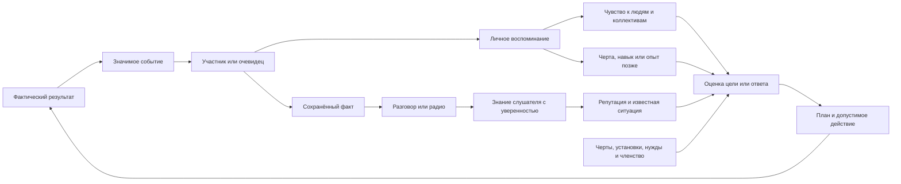

# Социальные системы NPC: от события до решения

Это карта **всей реализованной социальной системы**: что составляет личность
NPC, что он знает о других, как события превращаются в чувства и цели и где
каждый слой находится в коде. Имена `Feeling`, `Attitude` и других полей
оставлены рядом с русскими названиями, чтобы их можно было искать в исходниках.
Речь прежде всего о разумных живых NPC при включённой настройке NPC
personalities. Игрок может иметь записи об отношениях, но не получает NPC-шкалы
и стартовые черты.

Это обзор взаимодействия подсистем. Полные значения черт и их ID поддерживаются
в [справочнике черт](npc-traits-guide.md), механика памяти и отношений — в
[npc-personality.md](npc-personality.md), цели и планирование — в
[npc-intentions.md](npc-intentions.md), конкретные социальные эпизоды — в
[npc-social-stories.md](npc-social-stories.md), а контракт расширения модулей —
в [npc-content-modules.md](npc-content-modules.md). Здесь есть понятия, связи
между ними и указатели на каноничные участки кода.

## Общая модель

У игры нет одного «социального рейтинга» и одного центра, который принимает все
решения. На каждом NPC сосуществуют несколько слоёв:

1. **Кто я:** черты, склонности решений, меняющиеся установки и кратковременные
   эмоции. Они влияют на трактовку *любой* ситуации.
2. **Что я пережил:** собственные события и воспоминания. Опыт может изменить
   черту, навык, установку и отношение к участникам.
3. **Что я думаю о других:** чувства к людям, группам и фракциям, доверие,
   страх, привязанность, обида, долг и отдельное доверие лидеру.
4. **Что я знаю:** виденных людей и места, нужды, опасности, нарушения,
   подтверждённые или пересказанные факты с источником и уверенностью.
5. **Что я пообещал и чего добиваюсь:** обязательства, договорённости,
   привязанности, интересы, личные цели, планы и коллективные задания.
6. **Что произошло на самом деле:** действие и значимое событие. Только
   совершённое действие меняет мир и даёт другим основания для реакции.

Первое и второе не являются знаниями обо всех жителях города. Третье и
четвёртое субъективны: два свидетеля могут по-разному оценить одного человека.
Пятый слой конкурирует с голодом, опасностью, ресурсами и возможностью дойти до
цели. Фракция, группа и правила боевой вражды при этом остаются фактическими
игровыми состояниями, а не выводятся из симпатии.

Настройка `NpcPersonalitiesEnabled` включает этот дополнительный слой для
разумных живых NPC. Когда она выключена, `Bias` и `Attitude` возвращают
нейтральное значение, генератор социальных намерений не работает, а обычные
правила фракций, групп, выживания и боя остаются в игре. Система личности
дополняет старые сенсоры `MemorizedSensor`, исследованные места
`ExplorationData`, боевую вражду и существующее доверие лидеру; она не
подменяет их единым хранилищем.

## Короткий ответ

**Feeling (чувство)** — сохранённая оценка человека, группы или фракции в
`RelationshipRecord`, от −100 до +100. Например, помощь может прибавить чувство
к помощнику, нападение — уменьшить. У одного NPC есть *отдельные* записи о
конкретном человеке, его группе и его фракции.

**Attitude (текущее отношение к человеку)** — вычисляемый результат, а не ещё
одна сохранённая шкала. `PersonalitySystem.Attitude(наблюдатель, цель)` складывает
чувства к человеку, **нынешней** группе и фракции цели, а также возможное
смещение от черты, связанной с фракцией. Результат ограничен диапазоном
−100..100. Если наблюдатель уверенно знает о серьёзном неразрешённом нарушении
этого человека (`Violation ≥ 80`, `ViolationConfidence ≥ 80`), результат не
может быть выше −30. Старые положительные чувства при этом сохраняются.

Таким образом, `Feeling = +40` к знакомому и `Attitude = −30` к нему же
совместимы: знакомый всё ещё дорог NPC, но тот считает его нынешнее поведение
неприемлемым. После действительного разрешения инцидента ограничение исчезает,
и прежние чувства снова влияют на решения.

## Из чего складывается социальное поведение

### 1. Черты и шкалы самого NPC

`TraitInstance` — сохранённая черта вроде `kind`, `honest`, `reliable` или
`hotheaded`. У черты есть эффекты на оси `NpcPersonalityAxis`. NPC начинает с
трёх стартовых черт и одного или двух ещё не разрешённых стартовых
воспоминаний; другие черты можно получить через опыт. Черта может одновременно
влиять на несколько решений. Полный перечень — в
[справочнике черт](npc-traits-guide.md).

Оси бывают двух видов:

- **Склонности решения** (`Bias`): предметы, смелость, группа, закон, торговля,
  исследование, сострадание, припасы. Их значение получают из активных черт.
  `Law +20` повышает вес связанных с законом решений, а не задаёт шанс 20 %.
- **Меняющиеся установки** (`Disposition`): ценность человеческой жизни
  (`HumanLife`), круг заботы (`CareCircle`), доверие сообщениям (`MessageTrust`),
  тревога о дефиците (`Scarcity`) и терпение (`Patience`). Эффективное значение
  складывается из основы фракции, эффектов черт, **накопленного опыта** после
  разрешения воспоминаний и временного влияния голода, усталости или рассудка.
  Оно ограничено диапазоном −100..100. Сама сохранённая прибавка от опыта —
  только один из этих компонентов.

Эти оси характеризуют **наблюдателя**. Они отвечают на вопросы «как я отношусь
к насилию?», «склонен ли я верить рассказу?», «готов ли терпеть отказ?». Они не
являются оценкой конкретного знакомого. Текущая `Frustration` — ещё одно
кратковременное состояние: отказы и конфликты её поднимают, время и удачное
урегулирование снижают; терпение определяет, насколько легко NPC сорвётся.

Восемь склонностей используются как общие веса разных решений. `Item` влияет
на оценку находок, `Courage` — на реакцию на опасность и конфронтацию, `Group`
— на совместные действия и лидерство, `Law` — на реакцию на нарушения, `Trade`
— на обмен, `Explore` — на перемещение и исследование, `Compassion` — на помощь,
`Supplies` — на поиск и сбережение ресурсов. Это не восемь взаимоисключающих
типов личности: один человек может одновременно быть смелым, бережливым и
отзывчивым. `PersonalitySystem.Bias` складывает эффекты действующих черт для
одной склонности, включая условные эффекты для конкретного предмета.

Пять установок имеют собственную накопленную историю:

- `HumanLife` — ценность человеческой жизни: защита, месть, медицинская помощь
  и эмоциональная реакция на убийство. На неё проецируются также сострадание и
  закон; тяжёлое падение рассудка временно снижает её.
- `CareCircle` — насколько широко распространяется забота за пределы близких.
  Влияет на помощь чужому человеку; голод и недосып временно сужают её. В неё
  частично входят эффекты `Group` и `Compassion`.
- `MessageTrust` — готовность считать сообщения достоверными. Участвует в
  вычислении уверенности в слухах и реакции на опровергнутые заявления.
  Недостаток рассудка временно снижает её.
- `Scarcity` — тревога о нехватке ресурсов. Уменьшает готовность отдать еду и
  повышает ценность запаса. Голод поднимает её, но пригодная еда в инвентаре
  смягчает этот временный эффект.
- `Patience` — терпение в споре, при отказе, угрозе, предупреждении или
  извинении. Голод, недосып и низкий рассудок временно снижают её. Например,
  `patient` добавляет терпения, а `hotheaded` сильно уменьшает его.

Эффективную установку вычисляет `PersonalitySystem.Disposition`; она **не
тождественна** сохранённому `ExperienceValue`. При наблюдении значимого события
`NpcImmediateEmotion` может отдельно изменить восстановимый рассудок прямо
сейчас. Позднее разрешение воспоминания может сдвинуть накопленный опыт. Это
разные реакции с разным временем жизни.

#### Какие черты существуют

В стандартном каталоге сейчас **116 черт**: 50 стартовых и 66 приобретаемых.
Черта имеет постоянный строковый ID, имя, эффекты на оси, возможное условие
получения, конфликты и иногда особое поведение. Например, `kind` прибавляет
сострадание и групповую склонность; `honest` повышает закон и торговлю;
`deceptive` может ложно заявить о разрешении взять припасы; `likes_items`
относится к конкретной модели предмета. Противоположные стартовые черты вроде
`kind`/`cruel`, `lawful`/`rebellious` и `sociable`/`solitary` не выдаются вместе.

Приобретаемые черты разделены **по источнику опыта**, а не по отдельным
механизмам применения:

- **24 личных исхода:** выживание, насилие, помощь, предательство, обещания и
  другие переживания. Например, `selfless`, `mistrustful`, `protector`,
  `reliable`, `disillusioned`.
- **9 встреч с уникальными персонажами:** от `bear_resolve` после встречи с
  Big Bear до `sewer_dread`.
- **18 отношений с фракциями:** семейства `friend_*` и `wary_*`, приобретаемые
  после помощи, нападения или убийства при подходящей исходной черте. Они дают
  и обычные эффекты на склонности, и смещение отношения к членам конкретной
  фракции. Не у каждой фракции есть оба варианта; конфликтующие варианты одной
  фракции несовместимы.
- **15 мировых переживаний:** например, `refugee_solidarity`,
  `army_confidence`, `roadside_vigilance`, `convoy_hope`, `betrayal_scar`.
  Требуют соответствующей наблюдаемой встречи или мирового события и могут
  изменить отношение к фракции.

Точное имя, ID, численные эффекты и условие каждой из 116 черт приведены в
[каталоге черт](npc-traits-guide.md). Он служит единственным полным справочником
значений и ID; этот документ объясняет, как их читает движок. Новая черта не обязана иметь
собственную ветку в AI: обычный путь — зарегистрировать её эффекты на общие
оси. Для особого поведения модуль может добавить интерес, источник цели,
реакцию на событие или оператор.

### 2. Отношения с конкретными людьми и коллективами

`PersonalityState` хранит отдельные `RelationshipRecord` по устойчивым ID людей,
групп и фракций. В каждой записи есть `Feeling`; у персональной записи также
есть `Trust`, `Fear`, `Attachment`, `Grievance` и `Debt` (0..100): доверие,
страх, привязанность, обида и долг. Это разные величины. Например, можно
испытывать привязанность и одновременно держать обиду. Смена лидера не стирает
историю группы; одинаковые имена людей не объединяют записи.

Память о помощи или нападении меняет `Feeling` к участнику; эффект на его
группу и фракцию слабее. Слух, принятый с достаточным доверием, может изменить
мнение о названном человеке или фракции **без личного воспоминания о событии**.
Черта, привязанная к фракции, добавляет смещение при расчёте отношения к её
члену.

Для контекста целей есть похожий, но другой расчёт:

`NpcMotivation.Feeling = clamp(person.Feeling + group.Feeling + faction.Feeling + factionTraitBias + (Trust − Fear − Grievance) / 4)`.

Здесь `Feeling` — **поле мотивации**, рассчитанное по сохранённым чувствам и
социальным показателям, а не поле `Feeling` одной записи. Значение не включает
ограничение за `Violation`. `NpcValues.KnownAttitude` сейчас использует тот же
социальный расчёт и потому, несмотря на имя, не тождественно
`PersonalitySystem.Attitude`.

`TrustInLeader` — ещё отдельная игровая величина доверия **текущему лидеру**.
Она влияет, например, на сделки с ним и не равна `RelationshipRecord.Trust`.
При исключении из группы членство и это доверие меняются отдельно от
накопленной истории чувств.

### 3. Наблюдение, память, знание и слухи

Это четыре связанных, но разных вещи:

- **Значимое событие** (`SignificantEvent`) появляется после реального
  действия: подарка, нападения, кражи, обещания, ответа на предупреждение и
  т. п. У события есть участники, место, время и причинные ID.
- **Личная запись о пережитом** (`ObservedEvent`) появляется у участника или
  очевидца согласно правилам видимости. Подходящее событие запускает
  `MemoryInstance`: воспоминание сразу влияет на отношения и остаётся в их
  истории. Обычно через два игровых дня оно разрешается и может изменить
  черту, навык или накопленный опыт по установке. Это не то же самое, что
  узнать новость из разговора.
- **Знание** (`NpcKnowledge`) хранит факты (`NpcFact`), известных людей,
  места и выходы. Запись об известном человеке (`NpcKnownPerson`) содержит
  последний известный контекст: место, нужду в еде или медицине, опасность,
  подозреваемое нарушение, уверенность, причину, известное членство. Это
  представление NPC о мире; оно может быть неполным или устаревшим.
- **Слух** — пересказ сохранённого факта. Источник меняется на `Told`, число
  пересказов растёт, уверенность слушателя вычисляется из уверенности
  рассказчика, доверия и обиды к нему, склонности к группе и `MessageTrust`.
  Прямое наблюдение надёжнее слабого пересказа. Услышанное может менять
  репутацию и порождать цели, но не выдаёт слушателю память очевидца.

`Hostile` у известного человека отражает вражду по игровым правилам боя
(`AreEnemies`). Оно не означает «не нравится». NPC может быть боевым не-врагом,
но не желать с ним жить в группе. И наоборот, факт нарушения имеет свою
уверенность и не превращается в боевую вражду автоматически.

### 4. Обязательства, договорённости и привязанности

Кроме черт, шкал и памяти, у NPC сохраняются конкретные социальные состояния:

- **Обещание** (`NpcCommitment`) связывает обещавшего, получателя, ресурс,
  остаток и срок. Настоящая передача ресурса исполняет его; освобождение от
  обещания завершает без нарушения. Просрочка даёт получателю частную оценку
  `promise_broken`, запись в Read Records и факт, который он может пересказать.
  Автоматической рассылки слуха всем вокруг нет.
- **Договор об услуге**, разрешение на припасы, спор и привязанность к человеку,
  предмету или дому живут отдельно от общей симпатии. Они могут сделать
  конкретную цель актуальной даже при смешанных чувствах.
- **Группа и фракция** имеют фактическое членство и задания. Личные чувства к
  коллективу — ещё один слой; они не меняют членство сами по себе.

Есть черта `reliable` («надёжный»): она может появиться после исполненного
обещания, требует `honest` и добавляет склонности к закону и состраданию.
Недоверие к получателю само по себе сейчас не снимает действующее обещание.
При этом, как и другая цель, исполнение может задержаться из-за выживания,
невозможного маршрута, отсутствия ресурсов или боевой вражды.

### 5. Цели, планы и действия

`NpcGoalGenerator` сопоставляет нужды и **известные** обстоятельства с
ценностями NPC: питание, помощь, безопасность, справедливость, принадлежность,
исполнение обещаний и другими. У предложенной цели есть недостаток состояния,
важность и уверенность в фактах; её полезность вычисляется как
`deficit × importance × confidence / 10000`; для самостоятельного запуска
нужно не меньше 20. Существующие категории значимых состояний: `Nutrition`,
`Care`, `Reciprocity`, `Safety`, `Justice`, `Belonging`, `Autonomy`, `Recovery`,
`MedicalCare`, `Commitment`, `Restitution`, `Possession`, `ProtectHome`; модули
могут регистрировать дополнительные строковые значения. Фракционная политика
добавляет свои приоритеты заботы, безопасности, ресурсов и укрытия. Затем
планировщик ищет допустимые действия, а AI проверяет их при исполнении.
Предложение цели ещё не означает, что NPC немедленно совершит действие.

Существуют также личные намерения и длительные интересы, групповые и
фракционные задания. Они используют черты, отношения, знания и физические
условия, но могут иметь **свои** правила допуска. Поэтому социальная реакция
не сводится к одному глобальному числу.

## Жизненный цикл одного события

1. Игровое действие сначала проходит обычную проверку правил и **реально
   выполняется**. Например, предмет переходит из одного инвентаря в другой,
   меняется членство в группе или происходит удар. Успешный обработчик сообщает
   `SignificantEvent` через `RogueGame.ReportPersonalityEvent` либо через
   `NpcEvents.Publish` из модуля. Попытка, обдумывание действия и расчёт плана
   не дают исхода как свершившегося факта.
2. `PersonalitySystem.Report` проверяет контракт события в активном каталоге,
   назначает ID и определяет прямых участников и видящих его жителей. Для
   частного события (`isPrivate`) аудитория ограничена владельцем оценки.
   Участник или очевидец получает `ObservedEvent` с участниками, временем,
   `CauseId` и `StoryId`. Одновременно запись попадает в его сохранённую
   историю `ResidentRecords`.
3. Для каждого наблюдателя `NpcEventPipeline` сперва обновляет знание о
   видимых участниках, вызывает подписчиков `Knowledge`, сохраняет факт, если
   событие объявлено пересказываемым, затем вызывает подписчиков
   `Relationships` и обновляет свидетельства действующих воспоминаний. Совпавшие
   `MemoryTrigger` создают личные `MemoryInstance`; чувство к участникам
   меняется уже при создании. После этого фаза `Goals` обновляет предложения
   целей, а `Responses`/`Replies` могут подготовить ответ.
4. Ответ — тоже действие. `NpcReaction` хранит короткое ожидающее высказывание
   или выпад, но событие ответа публикуется, когда NPC действительно говорит
   или действует. Поэтому предупреждение, согласие и фактическое исправление
   поступка можно различать и связывать причинными ID.
5. После всех наблюдателей обновляется общий эпизод и выполняются
   `AfterEvent`-подписчики. Например, передача еды публикует `shared_food`,
   а модуль обещаний проверяет, закрыла ли эта передача действующее обещание.
6. На отдельном ходе карты наступившие воспоминания разрешаются. Через два
   игровых дня выбирается доступный исход из категорий «получить черту»,
   «улучшить навык», «убрать противоречащую черту» и «изменить опыт установки».
   Ни событие, ни черта не гарантируют конкретный исход. Разрешённое
   воспоминание покидает очередь ожидания, но остаётся в соответствующей
   истории отношений с итогом и временем.

### Когда событие становится слухом

Пересказ возможен только для события с `RetainFact` либо для отдельного
допустимого вывода, сохранённого как `NpcFact`. Факт имеет ID события,
источник (`Participant`, `Witness`, `Told`, `Inferred`), место, время события и
узнавания, уверенность, число пересказов и известные имена участников.
`NpcConversation` отбирает свежий факт, проверяет готовность рассказчика
сообщать о **собственном** полезном или вредном поступке и слушателя, затем
произносит фразу. Разговор могут услышать близкие бодрствующие жители даже
через препятствие, если хватает дальности слуха. Часть публичных просьб
распространяется так же без отдельного разговора.

`NpcKnowledgeSystem.Hear` понижает или повышает уверенность слушателя с учётом
отношения к **рассказчику**, `MessageTrust` и исходной уверенности. Более
слабый повтор не заменяет более сильное прежнее свидетельство. Подписчики
`OnReport` могут изменить репутацию названного человека или фракции
соразмерно **прибавке уверенности**, чтобы один и тот же слух не штрафовал
бесконечно. Пересказ о человеке не равен личному знакомству с его текущим
местоположением: он может быть старым, а участник может быть описан только как
«полицейский» или «байкер». Если имя не известно, оценка может относиться к
фракции, а не к конкретному незнакомцу.

Знание намеренно ограничено: до 48 фактов, 32 известных людей и 16 известных
мест; факты и места старше двух игровых дней могут удаляться. Журнал последних
личных событий также ограничен 32 записями. Это не стирает уже приписанную
конкретному человеку, группе или фракции историю воспоминаний после их
разрешения. Поэтому отсутствие старого факта в очереди слухов и сохранённое
плохое чувство к человеку не противоречат друг другу.

### Почему записи и знания различаются

`ResidentRecords` сохраняет индивидуальную хронологию для **Read Records**,
включая причины начала целей, фактические исходы и услышанную речь. Это
внешний просмотр сейва, а не общая память NPC. Участник может знать об
обещании, свидетель — помнить его произнесение, третий житель — получить
только слух, четвёртый — ничего не знать. Игрок во время игры видит свои
отношения через Shift+I и только реально услышанные реплики через J.

## Какие действия используют социальные данные

- **Приглашение, уход и исключение.** Правила допуска и реальные действия
  групп проверяют членство, лидерство, вражду и `Attitude` обеих сторон.
  Гражданский лидер сортирует подходящих видимых кандидатов по отношению,
  затем по расстоянию. Недоверие к лидеру и опасность могут мотивировать
  самостоятельный уход. Смена лидера сохраняет ID группы у преемника.
- **Обмен.** Гражданский AI может не начинать сделку при `Attitude ≤ −30`;
  доверие действующему лидеру имеет отдельное исключение. Реальная сделка
  меняет предметы и может создать отношение или воспоминание. Оценка товаров,
  наличия интересных предметов и законности сделки остаётся частью торговых
  правил, а не одной шкалы симпатии.
- **Помощь с едой и медициной.** Источники целей смотрят на известную нужду,
  уверенность, привязанность, сострадание, установку заботы, ценность жизни и
  собственные ресурсы. Они исключают боевых врагов (`Hostile`), но личная
  помощь не наследует автоматически порог приглашения. Доставка должна
  действительно передать или применить предмет.
- **Обещания и договоры услуг.** Произнесённое обещание создаёт сохранённое
  обязательство с получателем, ресурсом и сроком. Оно конкурирует с другими
  целями и закрывается результатом, а не хорошим намерением. Предложение
  лечения, согласие и выполнение также имеют отдельные состояния.
- **Нарушения, спор и примирение.** Уверенное известное нарушение может
  породить предупреждение, требование возмещения или исключение. Нарушитель
  отвечает сообразно собственным склонностям и состоянию; предупреждающий
  оценивает ответ сообразно своим. Обида, доверие, фрустрация и срок реакции
  меняются независимо. Извинение может смягчить отношение без возврата в
  группу; угроза и боевое нападение остаются разными событиями.
- **Поиск, защита и совместные задания.** Знание о пропавшем спутнике,
  опасности, доме, запасах или раненом создаёт личные цели и устойчивые
  интересы. Групповой или фракционный координатор предлагает видимому
  подходящему исполнителю общее задание; исполнитель получает свою цель.
  Фракционное задание не добавляет члена в группу. Задание на припасы,
  получатель которого вышел из группы, теряет смысл и завершается.
- **Разговоры и радио.** Готовность делиться своими действиями может зависеть
  от черт и склонностей. Речь передаёт факт, но не превращает слушателя в
  очевидца. Радионовость может отдельно повлиять на рассудок слушателя через
  установки и его отношение к участникам.

В каждом пункте сначала действуют физические и правовые ограничения игры,
затем допустимые социальные способы конкурируют с голодом, опасностью и
другими планами. Положительный вес цели не обещает, что действие произойдёт:
цель может уступить более важной, маршрут может исчезнуть, а адресат — уйти.

## Как всё соединяется

Read Records показывает сохранённую ретроспективную историю NPC, включая
события, цели и их исходы. Это **инструмент просмотра истории вне игрового
знания персонажей**: запись в архиве не означает, что все жители о ней знают.
Во время игры NPC видит только своё наблюдение и полученные сведения.

## Пример: два полицейских поссорились

Допустим, Джеральд хорошо помнит помощь Ллойда и его личное `Feeling`
положительно. Затем Джеральд узнаёт о серьёзной краже Ллойда с высокой
уверенностью. В `NpcKnownPerson` Ллойда появляется `Violation = 100`, поэтому
расчётный `Attitude` Джеральда к нему становится не выше −30. Если Ллойд состоит
в группе Джеральда, у лидера появляется основание для исключения; тот же порог
не позволяет тут же пригласить его обратно.

Предупреждение само по себе не разрешает нарушение. Ллойд отвечает согласно
своим склонностям к закону и состраданию, терпению и текущей фрустрации.
Принятие границы Джеральд оценивает **своими** состраданием, законом, терпением,
доверием сообщениям и обидой. Только принятый ответ, относящийся к текущему
инциденту, может снять ограничение `Violation`. Старое положительное чувство
после этого опять учитывается, но членство не восстанавливается автоматически:
нужны обычные условия и отдельное приглашение. Извинение может уменьшить
обиду и прибавить доверие без отмены нарушения.

Важная техническая тонкость: обычная цель помочь с едой использует
`NpcMotivation.Feeling`, а не `Attitude`, и проверяет `Hostile` как боевую
вражду. Поэтому положительные старые воспоминания могут всё ещё делать помощь
интересной даже после отказа в совместной жизни. Медицинская помощь также
учитывает ценность жизни. Это разные решения с разной ценой; они не обязаны
иметь один порог. Обычное **групповое** задание принести еду человеку с таким
нарушением уже не предлагается, но срочная групповая медицина возможна.
Если получатель вышел из группы, групповое задание прекращается.

## Каноничные места в коде

### Сохранённое состояние

- [`Actor.cs`](../WRogue/Data/Actor.cs) содержит `PersonalityState`, устойчивый
  `PersonalityIdentity`, существующее `TrustInLeader` и ссылку на лидера.
  [`SocialGroup.cs`](../WRogue/Data/SocialGroup.cs) содержит **действительное**
  членство, неизменяемый ID группы, лидера, состав и текущий групповой план.
- [`PersonalityState.cs`](../WRogue/Data/PersonalityState.cs) задаёт enum всех
  осей, экземпляр черты, наблюдённое событие, воспоминание, отношения к
  человеку/группе/фракции, опыт установок, фрустрацию и очередь памяти.
- [`NpcKnowledge.cs`](../WRogue/Data/NpcKnowledge.cs) хранит факты с источником
  и уверенностью, известных людей, места, выходы и границы этих списков.
  `NpcKnownPerson.Violation` — известная конкретному наблюдателю оценка
  нарушения; это не поле самого нарушителя.
- [`NpcSocialState.cs`](../WRogue/Data/NpcSocialState.cs) содержит обещания,
  споры, разрешения на припасы, договоры услуг, привязанности и известное
  правило группы. [`NpcIntent.cs`](../WRogue/Data/NpcIntent.cs),
  [`NpcGoals.cs`](../WRogue/Data/NpcGoals.cs) и
  [`NpcInterest.cs`](../WRogue/Data/NpcInterest.cs) — цели, реакции, их
  оценённые значения и устойчивые интересы. Общие эпизоды и планы хранятся
  отдельно в `NpcStories.cs` и `SocialGroup.cs`.
- [`ResidentRecords.cs`](../WRogue/Data/ResidentRecords.cs) и связанные
  частичные классы содержат сохранённый архив историй жителей. Это не источник
  знаний для NPC. Формат и совместимость сейвов описаны в
  [save-format.md](save-format.md).

### Определения правил

- [`PersonalityContent.cs`](../WRogue/Gameplay/Npc/Content/PersonalityContent.cs)
  регистрирует базовые черты и воспоминания; [`PersonalityWorldContent.cs`](../WRogue/Gameplay/Npc/Content/PersonalityWorldContent.cs)
  — встречи, фракции и мировые переживания. Особые черты, воспоминания,
  события, ценности, способности и ответы находятся в профильных
  `Content/<feature>/` модулях. Например, обещания — в
  [`PromisesModule.cs`](../WRogue/Gameplay/Npc/Content/Promises/PromisesModule.cs),
  нарушения и предупреждения — в
  [`JusticeModule.cs`](../WRogue/Gameplay/Npc/Content/Justice/JusticeModule.cs).
- [`NpcContentDefaults.cs`](../WRogue/Gameplay/Npc/Content/NpcContentDefaults.cs)
  собирает стандартные модули. [`NpcCatalogBuilder.cs`](../WRogue/Gameplay/Npc/Contracts/NpcCatalogBuilder.cs)
  регистрирует и проверяет контракты;
  [`NpcContentCatalog.cs`](../WRogue/Gameplay/Npc/Runtime/NpcContentCatalog.cs)
  — каталог активной игры. Правила модуля определяются при композиции, но
  сами объекты определений и callback-функции не записываются в сейв.
- [`Axes/`](../WRogue/Gameplay/Npc/Axes/) задаёт основу фракции, проекцию черт,
  временный контекст и некоторые немедленные эмоции для пяти установок.
  [`CoreEventsModule.cs`](../WRogue/Gameplay/Npc/Content/CoreEvents/CoreEventsModule.cs)
  регистрирует фракционные основы.

### Выполнение правил

- [`PersonalitySystem.cs`](../WRogue/Gameplay/Npc/Runtime/PersonalitySystem.cs)
  инициализирует NPC, вычисляет `Bias`, `Disposition`, `Attitude`, принимает
  события и разрешает воспоминания. Создание состояния вызывается из
  [`ActorModel.cs`](../WRogue/Data/ActorModel.cs).
- [`NpcEventDefinition.cs`](../WRogue/Gameplay/Npc/Events/NpcEventDefinition.cs)
  описывает полезную нагрузку, аудиторию, сохранение факта, текст архива и
  необязательные реакции на личное наблюдение события и сообщение о нём по радио.
  [`NpcObservation.cs`](../WRogue/Gameplay/Npc/Events/NpcObservation.cs)
  определяет порядок фаз наблюдения. Физические источники событий расположены
  в `RogueGame.Actions.*`, `RogueGame.Combat.cs`, `RogueGame.Events.cs` и в
  действиях профильных NPC-модулей.
- [`NpcMemoryProcessor.cs`](../WRogue/Gameplay/Npc/Memories/NpcMemoryProcessor.cs)
  создаёт память и сразу связывает её с историями отношений.
  [`NpcImmediateEmotion.cs`](../WRogue/Gameplay/Npc/Runtime/NpcImmediateEmotion.cs)
  отвечает за краткий эмоциональный эффект, в том числе от радио.
- [`NpcRelationshipValue.cs`](../WRogue/Gameplay/Npc/Relationships/NpcRelationshipValue.cs)
  суммирует личные и коллективные чувства;
  [`NpcReputation.cs`](../WRogue/Gameplay/Npc/Relationships/NpcReputation.cs)
  обрабатывает репутацию по услышанному;
  [`NpcReplies.cs`](../WRogue/Gameplay/Npc/Relationships/NpcReplies.cs)
  готовит ответы и срывы.
- [`NpcKnowledgeSystem.cs`](../WRogue/Gameplay/Npc/Knowledge/NpcKnowledgeSystem.cs)
  поддерживает видимые сведения и принимает сообщения;
  [`NpcConversation.cs`](../WRogue/Gameplay/Npc/Conversation/NpcConversation.cs)
  выбирает и распространяет слухи. Профильные модули дополнительно
  обрабатывают `Knowledge`, `Relationships` и `OnReport` для своих событий.
- [`NpcGoalContext.cs`](../WRogue/Gameplay/Npc/Goals/NpcGoalContext.cs)
  собирает доступное знание и `NpcMotivation`;
  [`NpcValues.cs`](../WRogue/Gameplay/Npc/Goals/NpcValues.cs)
  вычисляет важность и полезность;
  [`NpcGoalGenerator.State.cs`](../WRogue/Gameplay/Npc/Goals/NpcGoalGenerator.State.cs)
  запускает источники предложений;
  [`NpcGoalLifecycle.cs`](../WRogue/Gameplay/Npc/Goals/NpcGoalLifecycle.cs)
  поддерживает, выбирает и завершает цели. Планирование и повторная проверка
  действий — в [`Planning/`](../WRogue/Gameplay/Npc/Planning/).
- [`CivilianAI.cs`](../WRogue/Gameplay/AI/CivilianAI.cs) совмещает эти цели с
  обычным контроллером гражданского NPC, сенсорами, торговлей и приглашением.
  [`NpcStorySystem.cs`](../WRogue/Gameplay/Npc/Runtime/NpcStorySystem.cs) и
  [`NpcStorySystem.Groups.cs`](../WRogue/Gameplay/Npc/Coordination/NpcStorySystem.Groups.cs)
  координируют истории, преемственность и групповые/фракционные предложения.
  Конкретное правило всё равно находится в модуле, например
  [`GroupsModule.cs`](../WRogue/Gameplay/Npc/Content/Groups/GroupsModule.cs).
- [`RecordsReader.cs`](../WRogue/Engine/RecordsReader.cs) читает сохранённую
  хронологию **без восстановления игрового мира**. Он отображает факты и
  причинные связи, а не принимает решения за NPC.

### Как находить правило и добавлять новое

Если непонятно, почему NPC совершил действие, сначала найдите *выполненное*
событие в Read Records и его `CauseId`; затем профильный модуль по ID события,
его подписки `On(...)`/`OnReport(...)`, источник цели `Evaluate(...)` и
условия соответствующей способности или действия. Сравните три разные вещи:
сохранённое отношение в `RelationshipRecord`, текущий `NpcKnownPerson` и
вычисляемый вес цели. Полезно проверить настройки NPC personalities, линию
видимости, источник и уверенность факта, действительное членство, предметы и
маршрут. Отсутствие записи у одного NPC не доказывает отсутствия мирового
события: он мог не участвовать и не видеть его.

Новое социальное правило обычно помещается в существующий профильный модуль:
определение события с устойчивым строковым ID и контрактом, реакция нужной
фазы, при необходимости память/черта, значение цели, способность и реальное
действие. Модуль подключается один раз в `NpcContentDefaults`. Сохранённые
строковые ID, номера осей и пространства имён нельзя произвольно менять:
сейвы на них опираются. Проверка такого правила — именованный сценарий,
исполняющий действие и следующий за ним результат; подробный порядок в
[npc-content-modules.md](npc-content-modules.md) и
[gameplay-scenarios.md](gameplay-scenarios.md).

Дополнительные документы: [подробная механика черт и памяти](npc-personality.md),
[цели и намерения](npc-intentions.md), [социальные истории](npc-social-stories.md).
