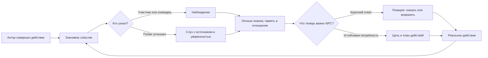

# Социальная система: планы и реакции

Текущий цикл уже соответствует идее «действие одного NPC вызывает реакцию других»:

## Что уже есть

- `PersonalitySystem.Report` определяет участников и свидетелей с учётом видимости и правил события.
- `NpcEventPipeline` проводит наблюдение через знания, отношения, память, цели и ответы.
- `NpcReaction` хранит короткий отложенный ответ. `ActionNpcReaction` проверяет возможность исполнения и лишь затем создаёт новое событие.
- `NpcIntent` хранит устойчивую цель; `NpcPlanRuntime` подбирает и перепроверяет шаги.
- Слух проходит через доверие и уверенность. Слушатель не получает память очевидца.

## Что стоит систематизировать

Для каждого социального эпизода записывать одну причинную цепь: **действие → аудитория → личное знание → оценка → быстрый ответ или цель → исполненный исход**. Короткий ответ и долговременная цель имеют разный срок жизни и могут возникнуть из одного события независимо друг от друга.

Правила конкретного эпизода лучше держать в его тематическом модуле. Например, правило кражи определяет, что свидетель знает о нарушении, кто хочет предупредить вора и какой ответ возможен. Общий цикл доставляет событие и выбирает законное действие.

Начать можно с одного сценария: А крадёт, Б видит и предупреждает, В слышит предупреждение и принимает собственное решение. Отдельно проверить NPC, который не видел и не слышал ничего. Это покажет фактический пробел без большого рефакторинга.

**Вывод:** разделение на реакции и планы полезно как язык проектирования и проверки причинности. Основные механизмы уже существуют; ближайшая работа — сделать их связь явной в конкретных эпизодах.
